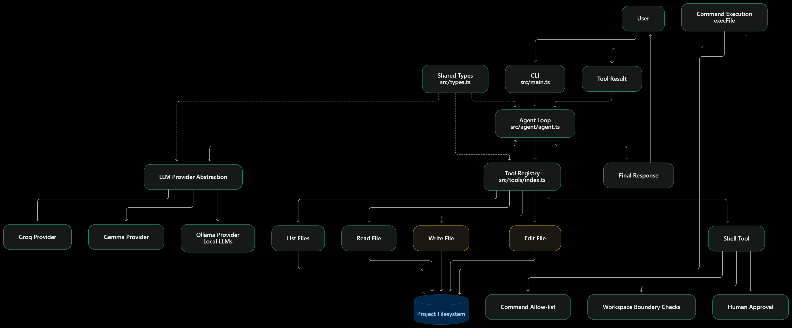

# Kern



A lightweight coding agent built from scratch in TypeScript and Node.js, to understand how AI coding agents work internally.

Kern is an educational project. Instead of treating a coding agent as a black box, it rebuilds the main pieces one at a time: the agent loop, the provider layer, the tools, and the safety checks around them. The goal isn't another chatbot. It's to see how an LLM becomes an agent once it can use tools, read the results, and keep going.

Kern is a work in progress. It works end to end today, and the roadmap at the bottom lists what's next.

---

## Table of Contents

1. [How It Works](#1-how-it-works)
2. [Current Features](#2-current-features)
3. [Getting Started](#3-getting-started)
4. [Project Structure](#4-project-structure)
5. [The Agent Loop](#5-the-agent-loop)
6. [Providers](#6-providers)
7. [Tools](#7-tools)
8. [Safety and Boundaries](#8-safety-and-boundaries)
9. [Windows and npm](#9-windows-and-npm)
10. [Testing](#10-testing)
11. [Known Limitations](#11-known-limitations)
12. [Roadmap](#12-roadmap)
13. [Design Philosophy](#13-design-philosophy)

---

## 1. How It Works

A normal LLM call is one step: you send a prompt and get an answer. A coding agent needs more. The model has to act on the outside world and see what happened.

```
User
  ↓
LLM
  ↓
Tool Call
  ↓
Tool Execution
  ↓
Tool Result
  ↓
LLM
  ↓
Tool Call / Final Response
```

The key idea is that **the LLM never executes anything itself.** It asks for a tool call, and Kern:

1. Receives the structured tool call.
2. Validates it.
3. Runs the matching tool.
4. Adds the result to the conversation.
5. Sends everything back to the model.

The model provides the reasoning. Kern provides the execution environment.

---

## 2. Current Features

- **Agent loop** that connects the LLM to tools and feeds results back, with a turn limit.
- **Streaming** of model output, including tool calls that arrive in fragments.
- **Provider abstraction** with three implementations: Groq, Google (Gemma), and Ollama.
- **Nine tools** for reading, searching, editing and writing files, plus allow-listed shell commands.
- **Workspace boundary checks** that block `..` escapes, outside absolute paths and symlink escapes.
- **Command allow-list and approval prompt** before any shell command runs.
- **Tool-call validation**, so malformed calls from the model are caught before execution.
- **Interactive terminal UI** with slash commands.
- **Automated tests** for the agent loop using a scripted mock provider.

---

## 3. Getting Started

### Requirements

- Node.js 18 or newer
- An API key for at least one provider (Groq by default)

### Install

```bash
npm install
```

### Configure

Create a `.env` file in the project root:

```env
GROQ_API_KEY=your_groq_key
GOOGLE_API_KEY=your_google_key   # only needed for the Gemma provider
OLLAMA_MODEL=qwen2.5-coder:7b    # optional, for the Ollama provider
```

`.env` is listed in `.gitignore`. Keep it out of version control and out of any zip you share.

### Run

```bash
npm run dev
```

Kern uses the folder you launch it from as its workspace, so run it from the project you want it to work on.

### Terminal commands

| Command | What it does |
| --- | --- |
| `/help` | Show available commands |
| `/clear` | Clear the conversation history |
| `/status` | Show the workspace, message count and registered tools |
| `/exit`, `/quit` | Leave Kern |

---

## 4. Project Structure

```
.
├── src/
│   ├── main.ts                  # Terminal UI and entry point
│   ├── types.ts                 # Shared types: messages, tools, events, providers
│   ├── list-models.ts           # Helper that lists models available on your Groq account
│   ├── agent/
│   │   └── agent.ts             # The agent loop
│   ├── provider/
│   │   ├── groq.ts              # Groq (default)
│   │   ├── gemma.ts             # Google GenAI
│   │   └── ollama.ts            # Local models through Ollama
│   └── tools/
│       ├── index.ts             # Tool registry
│       ├── readTool.ts
│       ├── lsTool.ts
│       ├── findTool.ts
│       ├── grepTool.ts
│       ├── searchTool.ts
│       ├── statTool.ts
│       ├── editTools.ts
│       ├── writeTool.ts
│       ├── shellTool.ts
│       ├── commandAllowList.ts  # Which commands may run
│       ├── approval.ts          # y/n approval prompt
│       ├── pathBoundary.ts      # Workspace path checks
│       └── fileSystemUtility.ts # Shared ignore rules
├── tests/
│   ├── agent.test.ts            # Agent loop scenarios
│   └── tools.test.ts            # Tool registry checks
└── test-project/                # Sample project Kern was tried on
```

---

## 5. The Agent Loop

The loop lives in `src/agent/agent.ts`. Each turn does this:

1. Send the message history and tool specs to the provider.
2. Stream the response, collecting text and tool calls.
3. If there are no tool calls, save the reply and finish with `success`.
4. Otherwise, validate the batch of tool calls.
5. Record the assistant's request in the history.
6. Run each tool and append its result as a `tool` message.
7. Go back to step 1.

### Validation

A batch of tool calls is rejected, and the run ends with an error, if any call:

- is missing an ID or function name
- reuses an ID already seen in the batch
- has arguments that aren't a JSON object, or aren't valid JSON

### Errors become observations

Failures inside a tool don't crash the agent. An unknown tool name, bad arguments or a thrown exception is turned into a result string and sent back to the model, which can then decide what to do next:

```
LLM → read("missing.ts") → Error: file not found → LLM → ls(".")
```

### Turn limit

The loop stops with an error after 10 turns (`MAX_TURNS`), so a confused model can't loop forever.

### Events

The loop reports progress through an event handler, which keeps the agent separate from the terminal UI:

```ts
type AgentEvent =
  | { type: "text"; content: string }
  | { type: "tool_call"; name: string; arguments: string }
  | { type: "tool_result"; name: string; result: string }
  | { type: "done"; status: "success" | "error" }
  | { type: "error"; message: string };
```

---

## 6. Providers

A provider is anything that implements one method:

```ts
interface LLMProvider {
  generateResponse(
    messages: Message[],
    tools: Tool[]
  ): AsyncIterable<LLMChunk> | Promise<AsyncIterable<LLMChunk>>;
}
```

Kern keeps its history in an OpenAI-style message format. Each provider translates that to its own API and streams back text chunks and tool calls.

| Provider | File | Model |
| --- | --- | --- |
| Groq | `provider/groq.ts` | `openai/gpt-oss-20b` |
| Google GenAI | `provider/gemma.ts` | `gemma-4-26b-a4b-it` |
| Ollama | `provider/ollama.ts` | `OLLAMA_MODEL`, default `qwen2.5-coder:7b` |

`main.ts` currently uses the Groq provider. To switch, change the provider passed to `runAgent` in `runPrompt`.

Note that `gemma.ts` throws at import time if `GOOGLE_API_KEY` is missing, and `main.ts` imports all three providers. Keep a value in `.env` for it, even a placeholder, or remove that import.

---

## 7. Tools

Every tool has a name, a description, a JSON Schema for its parameters, and an `execute` function:

```ts
interface Tool {
  name: string;
  description: string;
  parameters: Record<string, unknown>;
  execute: (args: Record<string, unknown>) => Promise<string>;
}
```

Tools are registered in `src/tools/index.ts`. The agent looks up the requested tool by name and calls `execute`. A tool only needs to take input, do its job and return a string. The model does the reasoning.

| Tool | Purpose |
| --- | --- |
| `read` | Read a text file |
| `ls` | Recursively list files and directories (skips `.git` and `node_modules`) |
| `find` | Find files by name substring, glob or regex, with an optional file/dir filter |
| `grep` | Regex search across files, with glob filter, case-insensitive option and a match cap (500 by default) |
| `search` | Plain text search that returns file paths, line numbers and matching lines |
| `stat` | Size, type, timestamps and permissions for a path |
| `edit` | Replace one exact, unique piece of text in a file |
| `write` | Create a file, or overwrite one when `overwrite: true` is set |
| `shell` | Run an allow-listed program with an argument array, after approval |

A few details worth knowing:

- `edit` fails if the text isn't found, or if it appears more than once. This stops the model from making a wrong change in the wrong place.
- `write` refuses to overwrite unless asked, only creates missing directories when `createDirectories` is set, and refuses to write through symlinks.
- `grep` skips files larger than 5 MB.

---

## 8. Safety and Boundaries

Giving a model a shell is risky, so the boundaries are part of the design.

### Workspace boundary

Most file tools call `resolveInsideWorkspace()` from `pathBoundary.ts`. It:

- collapses `..` segments before checking
- compares paths with `path.relative` rather than a string prefix, so `/ws-evil` isn't mistaken for being inside `/ws`
- follows symlinks with `realpath`, so a link pointing outside the workspace is rejected
- checks the nearest existing parent for files that don't exist yet
- rejects dangling symlinks, empty paths and null bytes

`write` and `shell` do their own checks: `write` checks the path and rejects symlinked parent directories, and `shell` checks that its working directory resolves inside the workspace.

### Command allow-list

`shell` only runs commands that pass `commandAllowList.ts`. The checks work in layers:

1. The executable must be on a fixed list (`node`, `npm`, `npx`, `tsc`, `git`, `python`, and a few others).
2. Executable names containing paths or shell operators are rejected.
3. The command and arguments must match an exact rule (for example `npm test`, `git status`, `npm run build`) or a restricted dynamic pattern:
   - `node <script>.js|mjs|cjs` with a safe relative path
   - `npm run <script>` with a plain script name
   - `npm install <packages>` with no flags
   - `npx <tool>` with plain arguments

Commands run with `shell: false`, so shell operators like `;`, `&&` and `|` have no special meaning.

### Approval

Before the shell runs anything, Kern prints the command, its arguments and its working directory, then waits for `y` or `n`. Anything other than `y` cancels the run and tells the model it was denied.

### Limits

Shell commands time out after 120 seconds and their output is capped at 5 MB.

---

## 9. Windows and npm

Running `npm` on Windows through Node's `execFile` doesn't work directly. Windows resolves `npm` to a shell-script launcher, which Node can't execute as JavaScript, and the call fails with a syntax error.

The fix is to skip the launcher and run npm's JavaScript entry point through the Node executable:

```
node  <npm install dir>/node_modules/npm/bin/npm-cli.js  <args>
```

`shellTool.ts` does this for `npm` and `npx` on Windows. The path is currently hardcoded to `C:\Program Files\nodejs\...`, so a Node install in a different location will fail. See the roadmap.

---

## 10. Testing

Tests use Node's built-in test runner. There's no `test` script in `package.json` yet, so run them with:

```bash
npx tsx --test tests/*.test.ts
```

`agent.test.ts` drives the real agent loop with a scripted provider that replays fixed responses. That makes the tests deterministic and keeps them from calling any real API. It also records the history the "model" received, so tests can check what was fed back. Scenarios covered:

1. A final response with no tool calls finishes successfully.
2. A tool call runs, its result reaches the model, and the agent finishes.
3. Multiple tool calls across turns all run and are fed back.
4. An unknown tool is reported back and the agent continues; malformed arguments and duplicate IDs abort with a validation error.
5. A tool that throws becomes an error result and the agent continues.
6. The agent stops with an error after hitting the turn limit.

`tools.test.ts` checks that every registered tool has a unique name, a description, a schema and an `execute` function.

---

## 11. Known Limitations

- The provider is hardcoded to Groq in `main.ts`.
- Conversation history grows without limit. There is no pruning or summarization yet.
- The npm path on Windows is hardcoded.
- `edit` and `write` don't ask for approval. Only `shell` does.
- `write` has its own path check instead of the shared `resolveInsideWorkspace()`.
- The path boundary check is check-then-use, so a symlink swapped in after the check isn't caught. Closing that gap would need a sandbox. The helper has been tested on Linux, not on Windows or macOS.
- No tests yet for the tools themselves, apart from the registry check.
- The shell tool's `path` parameter is marked required in the schema, though the code treats it as optional.

---

## 12. Roadmap

Next up:

- Reliably create a project, run it, diagnose errors and verify its own fixes
- Provider selection through config or a command-line flag
- Detect the npm location on Windows instead of hardcoding it
- Use `resolveInsideWorkspace()` in `write` and `shell`
- Approval for file-modifying tools
- Tests for the tools and the path boundary helper
- A `test` script in `package.json`

Later:

- Context management: pruning, summarization, tool-result compression
- Better output limits and timeouts across tools
- Sandboxing

---

## 13. Design Philosophy

1. **Understand before abstracting.** Kern builds the mechanisms directly instead of reaching for an agent framework.
2. **Small components.** Each part has one clear job: provider, loop, registry, individual tools.
3. **Incremental development.** The project grows one capability at a time: LLM calls, streaming, tool calling, the agent loop, filesystem tools, shell, safety checks.
4. **Architecture over copying.** The aim is to understand the ideas behind coding agents, not to reproduce one line by line.

The central idea fits in one sentence: an agent is not a different kind of model. It's an LLM running inside a system that gives it tools, state and a loop.

```
LLM + Tools + Execution + Context + Agent Loop = Coding Agent
```
